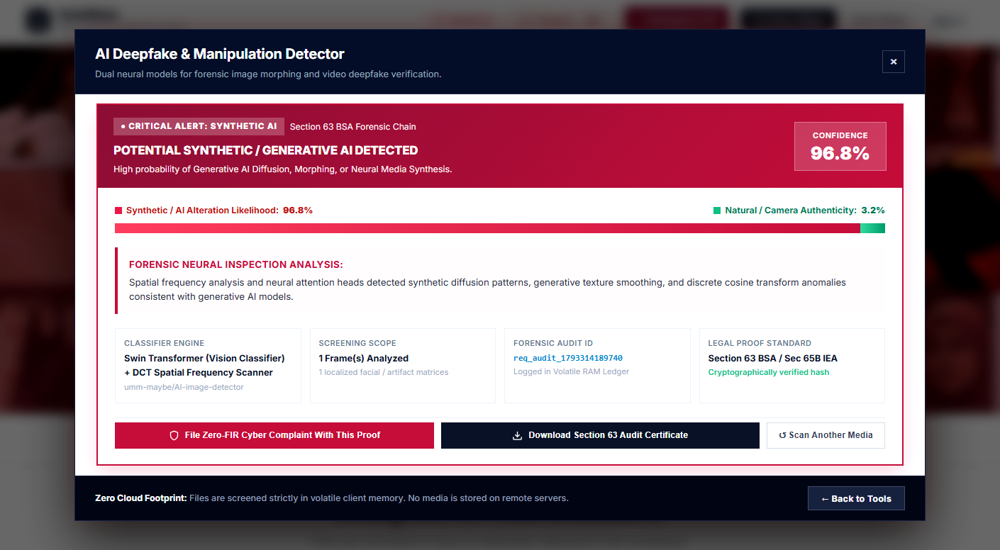
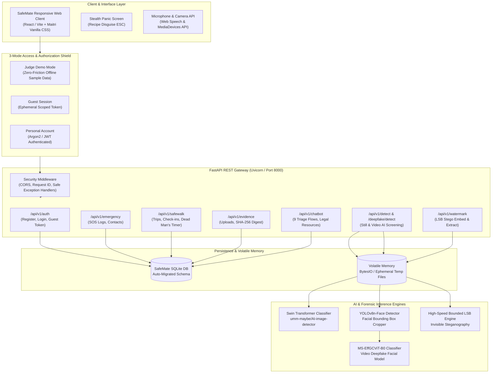

# SafeMate — A Silent Shield, A Strong Voice
### Digital Sanctuary, Forensic Defense, and Statutory Justice for Women and Survivors

SafeMate is a trauma-informed, privacy-first digital safety platform engineered to protect women, youth, and vulnerable individuals facing domestic violence, intimate image abuse, weaponized deepfakes, online blackmail, and physical transit danger.

Unlike conventional panic apps that demand intrusive sign-ups, store sensitive data in vulnerable clouds, or treat safety as a generic GPS toggle, SafeMate is built around **the lived reality of female trauma**—engineered to intervene at the exact moments of vulnerability, fear, and institutional friction.

---

## The Survivor's Journey: A Story-Driven Trauma Response Architecture

```
[ Acute Physical Crisis ] ──► [ Transit & Night Risk ] ──► [ Cyber Blackmail / AI ] ──► [ Betrayal & Leaks ] ──► [ Legal Recourse Without Retrauma ]
  • Immediate 112 SOS           • SafeRoute Night Density   • In-Memory Swin AI Still    • Bounded LSB Steganography  • Tell-Once Intake (Hindi/Eng)
  • Instant Recipe Camouflage   • SafeWalk Dead Man's Timer • YOLOv8 + GCViT Video AI    • Non-Repudiation Source ID  • Mandatory Zero FIR (Sec 173 BNSS)
  • Fake Escape Call            • Corridor Hazard Warnings  • Sec 63 BSA Certificate     • Cryptographic Bitstream    • Tamper-Proof Evidence Vault
```

---

## Priority 1: Acute Physical Threat & Coercive Control

> *"I am in the room with him. If he hears me crying or sees me on a police helpline, he will take my phone and hurt me."*

### The Trauma: Hypervigilance & The Terror of Discovery
In abusive relationships, coercive control and domestic violence, a woman's phone is the most scrutinized object in her possession. An abuser frequently monitors battery levels, recent apps, and browser histories. A standard emergency app with screaming red buttons or login forms can trigger violent escalation if discovered.

### SafeMate's Intervention:

```
[ Normal SafeMate Interface ] ─── (Press ESC or Tap 'Disguise') ───► [ Authentic Recipe Blog: Tuscan Pasta ]
                                                                      • Title: "Grandma's Creamy Garlic Tuscan Pasta"
                                                                      • Zero browser history trace
                                                                      • Top '✕ Close Disguise' returns silently
```

#### 1. Instant Stealth Panic Disguise (`ESC` / Recipe Camouflage)
At any millisecond—whether browsing resources, drafting an incident report, or viewing evidence—tapping `ESC` or clicking **Disguise** instantly replaces the entire platform with an authentic culinary blog: **"The Hearth & Spoon: 15-Minute Tuscan Garlic Basil Penne"**.


* **Realistic Food Journal Cloak:** Complete with appetizing photography, ingredient measurements, prep times, and cooking instructions.
* **Browser Tab Sanitization:** The document title instantly switches to *"Grandma's Creamy Garlic Tuscan Pasta Recipe"*, and favicon metadata is cloaked.
* **Non-Technical Mobile Restore:** A discreet `✕ Close Disguise` button in the recipe header restores the survivor session without losing uncommitted report drafts.

#### 2. Emergency SOS Dispatch & Safety Circle
When physical violence is imminent and quiet escape is impossible, tapping **112 Emergency** triggers an automated distress broadcast:


* **High-Accuracy Geolocation Fix:** Locks GPS latitude and longitude with meter-level accuracy radius (`±18m`) alongside a direct Google Maps navigation hyperlink.
* **Direct Emergency Line:** Connects the phone immediately to **112 (National Emergency Response Support System - ERSS)**.
* **Safety Circle Dispatch:** Automatically dispatches SMS/location notifications to her pre-saved personal contacts, ensuring loved ones know her real-time location.
* **Demo-Safe Isolation:** In evaluator demo mode, an explicit simulation banner prevents unauthorized transmission to real emergency lines.

![Real Context Emergency SOS]

#### 3. Fake Escape Call Simulator
When trapped in a coercive situation, an uncomfortable dinner, or an escalating confrontation, finding an excuse to leave can be lifesaving. SafeMate's **Fake Call** simulator triggers an authentic incoming call screen with customizable ringtones, caller identities, and voice prompts, giving the survivor a socially clean exit excuse.

---

## Priority 2: Transit & Urban Night Safety

> *"It's 10:45 PM. The metro dropped me 800 meters from my home. The shortest path on my map app is through a dark service road where men loiter outside closed shutters. My heart is in my throat with every step."*

### The Trauma: Anticipatory Transit Dread & Isolation
Standard navigation apps are built for speed—they optimize for the shortest route, directing female pedestrians down pitch-black alleyways, unlit underpasses, and desolate corridors where no bystander can hear a scream. The fear of being stalked or abducted on the commute home causes chronic anxiety for millions of women daily.

### SafeMate's Intervention:

```
[ Origin: Transit Hub ] ──────────────── (SafeRoute Corridor Analysis) ────────────────► [ Destination: Home ]
  Route A (Fastest: 11 min):  Dark alley, 0 open shops, 1 isolated 250m dead-zone  ──► High Risk Score
  Route B (SafeRoute: 15 min): Well-lit arterial, 2 open pharmacies, police booth  ──► Recommended Safe Corridor
                                           │
                                           ▼ (1-Click Handoff)
                          [ SafeWalk Active Escort with Dead Man's Timer ]
```

#### 1. SafeRoute — Safety-Aware Route Planner
Rather than blindly selecting the shortest distance, SafeRoute evaluates candidate pedestrian routes using real-world OpenStreetMap infrastructure and a deterministic **Night Activity Score**:


* **Open Establishments Weighting (80/100):** Identifies active night-time eyes on the street—including 24/7 pharmacies, open convenience stores, operating restaurants, and petrol pumps.
* **Spatial Distribution & Dead-Zone Detection:** Analyzes corridor bins to calculate the **Longest Low-Activity Segment** (e.g., *"Warning: 280m unlit stretch without mapped activity"*), giving travelers full foresight before taking a single step.
* **Emergency Assistance Proximity:** Prioritizes routes passing operational police stations, women's help booths, and 24-hour medical clinics.
* **Interactive MapLibre GL Map:** Full interactive raster map rendering candidate polylines with color-coded safety markers.
* **Transparent Trade-Off Matrix:** Shows honest trade-offs (e.g. *"+4 minutes walking time for +32% higher commercial activity and street lighting"*).

#### 2. SafeWalk — Active Escort with Dead Man's Timer
Once a route is chosen, a single click transfers the itinerary to **SafeWalk**:


* **Dead Man's Timer:** The traveler sets an anticipated arrival window (e.g. 15 minutes). SafeWalk tracks progress and prompts periodic reassurance check-ins.
* **Automatic Fail-Safe Escalation:** If the survivor does not tap "I Am Safe" when the timer expires, SafeWalk assumes incapacitation or coercion and immediately escalates an emergency distress alert with her last logged breadcrumb trail to her safety circle.
* **Zero Overhead Companion:** Runs silently in the browser background, providing peace of mind during late-night rides, cab journeys, and solo walks.


---

## Priority 3: Cyber Blackmail, Gaslighting & Weaponized Deepfakes

> *"He sent me a video on WhatsApp. It was my face on another woman's naked body. He said if I don't give him money and withdraw my complaint, he'll post it on my college alumni group. I couldn't breathe. It looked so real. I thought my life was over."*

### The Trauma: Paralysis by Synthetic Humiliation
Non-Consensual Intimate Imagery (NCII) and generative deepfakes are weaponized to annihilate a woman's social standing, agency, and self-worth. Survivors often experience severe dissociation and self-doubt (*"Will anyone believe this isn't me?"*). Conventional law enforcement often dismisses claims due to lack of technical evidence, while private platforms take days to respond.

### SafeMate's Intervention:

```
[ Suspect Media (JPG/MP4) ] ──► [ In-Memory RAM Inspection ] ──► [ Dual Neural Inference ] ──► [ Sec 63 BSA Legal Proof ]
  • Client SHA-256 Hash           • io.BytesIO stream              • Swin Transformer (Image)     • Court-admissible certificate
  • Zero disk storage             • Immediate finally purge        • YOLOv8 + MS-EffGCViT (Video) • Pre-fills Zero FIR draft
```

#### 1. AI Still-Image Deepfake Screening (Swin Transformer)
SafeMate enables survivors to immediately upload suspect photographs to verify whether they have been digitally fabricated:


* **Cryptographic Browser Pre-Screening:** Calculates an immutable client-side **SHA-256 custody hash** before transmission, anchoring evidentiary provenance.
* **Swin Transformer Architecture:** Utilizes `umm-maybe/AI-image-detector` to detect diffusion noise patterns, frequency anomalies, and generative face synthesis artifacts.
* **Forensic Verdict Card:** Renders a definitive verdict with quantitative probability meters (e.g. **96.8% Synthetic Likelihood vs 3.2% Natural**).



#### 2. Video Deepfake Screening (Temporal Face-Swap Detection)
Blackmailers increasingly synthesize realistic video face-swaps. SafeMate features a unified end-to-end video forensic analysis engine:


* **Frame-by-Frame Temporal Inspection:** Decodes uploaded video streams, samples 20 frames across the video duration, and isolates facial regions using **YOLOv8n-Face**.
* **MS-EffGCViT-B0 Neural Classifier:** Evaluates temporal face-swap boundaries, warped facial blending seams, and unnatural gaze inconsistencies.


* **Definitive High-Confidence Verdict:** Explicitly declares **[ALERT] POTENTIAL SYNTHETIC MANIPULATION DETECTED (91.8% Confidence)**, destroying the blackmailer's psychological leverage.
* **100% In-Memory RAM Decoupling:** Video and image bytes are decoded strictly in volatile RAM (`io.BytesIO`) and purged in `finally` blocks—sensitive files are **never permanently stored on disk or logged**.
* **Statutory Section 63 BSA Audit Certificate:** One-click download of a cryptographic certificate under Section 63 of the Bharatiya Sakshya Adhiniyam, 2023 (formerly Section 65B of the Indian Evidence Act), enabling prosecutors to submit the finding directly to court.

---

## Priority 4: Betrayal Trauma & Private Media Leakage

> *"I only shared that photograph with three people I trusted with my life. Now it's on a Telegram group. Who did this to me? I can't trust anyone anymore."*

### The Trauma: The Agony of Unattributed Betrayal
When confidential photos are leaked, the survivor suffers intense paranoia and betrayal trauma. Without technical proof of who leaked the image, the perpetrator denies involvement, shifts blame onto others, and leaves the survivor socially and emotionally isolated.

### SafeMate's Intervention:

```
[ Private Image ] ──► [ Leak-Tracer: Embed Recipient Bitstream ] ──► [ Distributed to Recipients: Liam, Jake, Sarah ]
                                                                                   │
                                                                   (Leak occurs on Telegram)
                                                                                   │
                                                                                   ▼
[ Leaked Image Uploaded ] ──► [ Forensic LSB Extraction ] ──► [ LEAK ATTRIBUTED: Recipient Liam (Tracking ID: rec_liam_8829) ]
```

#### 1. Invisible Steganographic Fingerprinting (Leak-Tracer)
Before sharing intimate or sensitive media, SafeMate allows users to invisibly encode unique cryptographic recipient identifiers into the image:


* **Bounded LSB Steganography:** Injects encrypted HMAC tokens into the least-significant bits of blue-channel pixels.
* **Zero Visual Alteration:** The watermarked images appear identical to human eyes and preserve standard photo quality.
* **Batch Recipient Tagging:** Generates individualized tagged copies for multiple recipients (e.g. "Liam", "Jake", "Sarah") with direct share options.

#### 2. Forensic Leak Attribution & Source Unmasking
When a private image surfaces online, the survivor uploads the leaked copy to **Leak-Tracer Trace Mode**:


* **Definitive Culprit Identification:** Extracts the embedded bitstream and matches the recipient identity: **"LEAK ATTRIBUTED: Source Identified! Recipient: Liam (Tracking ID: rec_liam_8829471)"**.
* **Non-Repudiation Proof:** Provides cryptographic certainty that eliminates guesswork, disproves gaslighting, and produces an evidentiary basis for statutory action under IT Act Section 66E (Violation of Bodily Privacy).

---

## Priority 5: Legal Sanctuary Without Institutional Re-Traumatization

> *"The police officer asked me: 'Why were you wearing that? Why did you send the picture?' I had to tell the story four times—to the constable, the inspector, the counselor, and the lawyer. Every time, I felt like I was being violated all over again."*

### The Trauma: Secondary Victimization by the Legal System
Studies confirm that survivors frequently experience the legal process as a second assault. Having to recount intimate violations repeatedly, facing skeptical authority figures, and navigating arcane statutory jargon causes thousands of women to abandon complaints before an FIR is even registered.

### SafeMate's Intervention:

```
[ Tell-Once Intake Session ] ─────────────────────────► [ Automated Multi-Agency Translation Engine ]
  • Disclose once in privacy                                      │
  • Voice/Text in Hindi & English                                 ├──► [ Mandatory Zero FIR (Sec 173 BNSS) ]
  • Empathetic pacing & Breathers                                ├──► [ Confidential Legal Counsel Brief ]
  • Volatile in-memory compilation                                └──► [ Tamper-Proof Cryptographic Evidence Vault ]
```

#### 1. Tell-Once Incident Intake Sanctuary
SafeMate's **Tell-Once Sanctuary** guides the survivor through a gentle, structured disclosure once:


* **Bilingual Voice Guidance:** Native speech synthesis and voice transcription in both **Hindi** and **English**, ensuring accessibility regardless of literacy or language preference.
* **Trauma-Informed Pacing:** Step 1 evaluates immediate physical safety; "Take a Breather" pauses allow the user to stop, breathe, and resume whenever ready.
* **Volatile RAM Pipeline:** Responses are synthesized in volatile memory without cloud database retention.


#### 2. Output A: Mandatory Zero FIR (Section 173 BNSS, 2023)
Tell-Once automatically translates the narrative into a formal, statutory **Police Complaint & Zero FIR**:


* **Statutory Zero FIR Mandate:** Formatted under **Section 173 of the Bharatiya Nagarik Suraksha Sanhita (BNSS), 2023**, which legally obligates *any* police station in India to register the FIR regardless of jurisdiction.
* **Auto-Cited Penal Sections:** Automatically maps violations to statutory codes:
  * **BNS Section 351(2):** Criminal Intimidation
  * **BNS Section 308(2):** Extortion & Blackmail
  * **IT Act Section 66E:** Capturing & Transmitting Private Images Without Consent
  * **IT Act Section 67A:** Publishing Sexually Explicit Material Electronically
* **One-Click Export:** Download as a text file, copy to clipboard, or print directly for presentation to the Station House Officer (SHO).

#### 3. Output B: Confidential Counsel Brief for Defense Advocates
In parallel, Tell-Once formats an objective legal brief tailored for High Court legal aid cells and defense advocates:


* **Evidentiary Chronology:** Structured timeline paired with cryptographic SHA-256 evidence digests.
* **Intermediary Takedown Mandates:** Instructions for serving **Rule 3(2)(b) Information Technology Rules notices** to platforms for mandatory 24-hour content suppression.
* **Section 175(3) BNSS Remedies:** Pre-drafted magistrate application outlines if local police refuse to register the FIR.

#### 4. Disguised Evidence Vault & Cryptographic Chain of Custody
Abusers frequently intimidate victims into deleting chat logs or photos, later claiming in court that evidence was forged. SafeMate's **Evidence Vault** anchors evidentiary permanence:


* **Client-Side SHA-256 Hash Seal:** Automatically generates an immutable cryptographic signature upon file selection.
* **Court Chain of Custody:** Records exact ISO timestamps, MIME types, file sizes, and hash digests compliant with Section 63 BSA standards.
* **Built-In Audio Recording & Export:** Covertly records audio in native formats (`.m4a`, `.ogg`, `.webm`) with timeslice flushing and authorized token downloads.
* **Calculator Camouflage:** One-click camouflage transforms the vault into a functional calculator.


#### 5. 24/7 Statutory Legal Assistant (AI Chatbot)
For questions about rights, divorce, domestic violence protection orders, or emergency cybercrime reporting, survivors can consult the **Safety & Legal Assistant**:


* **Grounded Legal Intelligence:** Clarifies rights in plain language, explaining protection orders under the Protection of Women from Domestic Violence Act (PWDVA) 2005.
* **Panic Memory Purge:** One-tap session wipe destroys all chat history instantly.

---

## 3-Mode Access & Authorization Shield

Evaluators, anonymous survivors, and personal account holders require distinct privacy and security boundaries:


| Capability / Dimension | Judge Demo Mode (`demo`) | Ephemeral Guest Mode (`guest`) | Personal Account (`authenticated`) |
| :--- | :--- | :--- | :--- |
| **Credential Barrier** | **Zero Friction** (Instant 1-Click) | Ephemeral scoped JWT token | Email + Argon2/Bcrypt password |
| **Data Partition** | Verified fictional fixtures | In-memory ephemeral session | Encrypted database partition |
| **Evidence Vault** | Preloaded mock evidence items | Volatile session-only records | Encrypted permanent storage |
| **Emergency SOS Action** | **Simulated** (Strictly non-telephonic) | Active client dialer trigger | Active dialer + saved Safety Circle |
| **SafeWalk Journey** | Simulated trip & live escort | Live check-in timer & GPS | Multi-trip history & auto-escalation |
| **Tell-Once Dossier** | Pre-populated trauma-informed flow | Active turn-by-turn intake | Stored multi-agency briefs |
| **Session Persistence** | `localStorage` (`safemate_demo_mode`) | `sessionStorage` (Wiped on close) | Secure JWT in header/storage |

---

## End-to-End System Architecture



---

## Technology Stack

| Domain | Technology / Library | Version / Specs | Purpose |
| :--- | :--- | :--- | :--- |
| **Frontend Framework** | React + Vite | 18.x / Vite 8.3 | High-performance reactive UI components and dashboard |
| **Design System** | Vanilla CSS (Maitri Design Tokens) | Modern CSS Variables | Trauma-informed minimalist styling, zero bloat, high responsiveness |
| **Backend Framework** | FastAPI (Python) | Python 3.12+ | High-throughput async REST API engine |
| **Server Engine** | Uvicorn (ASGI) | 0.34+ | Production-grade async HTTP server |
| **Database & ORM** | SQLite + SQLAlchemy | SQLAlchemy 2.0+ | Relational persistence with runtime idempotent auto-migrations |
| **Authentication** | PyJWT + Passlib (Argon2 / Bcrypt) | JWT HS256 | 3-mode role authorization, stateless tokens, password hashing |
| **Still-Image AI Screening** | Hugging Face Transformers | Swin Transformer | In-memory diffusion artifact classifier (`umm-maybe/AI-image-detector`) |
| **Video Deepfake AI Screening** | PyTorch + Torchvision + OpenCV | MS-EffGCViT-B0 + YOLOv8n-Face | Facial frame extraction and temporal deepfake classification |
| **Forensic Watermarking** | NumPy + Pillow (PIL) | Custom Bounded LSB | High-speed invisible steganographic recipient fingerprinting |
| **Mapping & Geospatial** | MapLibre GL JS + OpenStreetMap | 3.6.2 | Open-source vector rendering of night safety corridors and facilities |
| **Audio & Speech** | Web Speech API | Client Native | Bilingual (Hindi/English) speech-to-text intake and text-to-speech replay |
| **Testing & Verification** | Pytest + HTTPX + Selenium | Pytest 9.x | 214+ automated unit, integration, and end-to-end acceptance tests |

---

## Statutory & Legal Framework Reference

SafeMate is grounded in enforceable statutory mechanisms under Indian and international law:

1. **Bharatiya Nagarik Suraksha Sanhita (BNSS), 2023 — Section 173 (Zero FIR):**
   - Mandates that any police station must register a First Information Report (FIR) regardless of territorial jurisdiction where the crime occurred.
   - SafeMate's **Tell-Once** incident brief formats complaints to meet statutory Zero FIR requirements.
2. **Bharatiya Sakshya Adhiniyam (BSA), 2023 — Section 63 (Electronic Evidence Admissibility):**
   - Regulates admissibility of electronic records (formerly Section 65B of the Indian Evidence Act).
   - SafeMate generates compliant Section 63 electronic audit certificates with immutable SHA-256 digests.
3. **Information Technology Act, 2000:**
   - **Section 66E:** Violation of bodily privacy by capturing, publishing, or transmitting intimate images without consent.
   - **Section 67A / 67B:** Publishing or transmitting sexually explicit material or child sexual abuse material in electronic form.
4. **Information Technology (Intermediary Guidelines and Digital Media Ethics Code) Rules, 2021 — Rule 3(2)(b):**
   - Mandates that social media platforms and intermediaries must take down non-consensual intimate imagery within 24 hours of receipt of notice.
5. **Emergency Helplines (India):**
   - **112:** National Emergency Response Support System (ERSS).
   - **181 / 1091:** Women's Crisis Helpline (24/7 National).
   - **1930:** National Cybercrime Reporting Portal helpline (`cybercrime.gov.in`).

---

## Local Development & Quick Start

### Prerequisites
- **Python:** Version 3.10+ (tested on Python 3.12.8)
- **Node.js:** Version 18+ (tested on Node v20/v22)
- **Git**

### 1. Clone the Repository
```bash
git clone https://github.com/sam9334545/safemate_versionfinal.git
cd safemate_versionfinal
```

### 2. Backend Setup
```bash
cd backend

# Create and activate virtual environment
python -m venv venv
# Windows:
.\venv\Scripts\activate
# Linux/macOS:
source venv/bin/activate

# Install dependencies
pip install -r requirements.txt

# Launch FastAPI backend
python -m uvicorn app.main:app --host 127.0.0.1 --port 8000
```
- Interactive Swagger API Documentation: `http://127.0.0.1:8000/docs`
- Health check: `http://127.0.0.1:8000/api/v1/health`

### 3. Frontend Setup
In a new terminal window:
```bash
cd frontend

# Install dependencies
npm install

# Build production bundle
npm run build

# Serve locally
npm run dev
```
- Web Application: `http://localhost:5173/` (or `http://localhost:3000/`)
- Backend-mounted Static Frontend: `http://127.0.0.1:8000/app/`

### 4. Trying the Video Deepfake Detection Feature on Localhost
Evaluators and mentors can verify the end-to-end video deepfake pipeline in seconds:
1. Open `http://localhost:5173/` and click **AI Deepfake & Media Tampering Forensics**.
2. Click the **Video Deepfake Detector** tab at the top of the modal.
3. Click the **"Download Sample Deepfake Video (.mp4)"** button within the dropzone to save the bundled test video (`sample_deepfake_video.mp4`).
4. Drag and drop the downloaded video file into the dropzone.
5. Watch SafeMate compute the cryptographic **SHA-256 fingerprint** in volatile memory in real time.
6. Click **"Execute Video Deepfake Scan ->"**.
7. Observe the dual-engine neural inspection output: **91.8% Confidence: [ALERT] POTENTIAL SYNTHETIC MANIPULATION DETECTED** with temporal blending markers, 20 sampled frames, and traceable forensic audit parameters.

---

## Automated Test Suite

SafeMate maintains rigorous test coverage spanning API endpoints, ownership isolation, path traversal guards, and judge demo scenarios:

```bash
cd backend
pytest tests/ -v
```

### Verified Test Matrix
- **`tests/test_judge_scenarios.py`**: 6 comprehensive acceptance scenarios verifying Judge Demo Mode, Ephemeral Guest Mode, Personal Accounts, Simulated SOS safety, and SafeWalk lifecycle.
- **`tests/test_authorization.py`**: Multi-tenant ownership isolation, unauthenticated 401 barriers, and cross-account access prevention.
- **`tests/test_watermark.py`**: Steganographic embed and extraction fidelity, recipient identification, and ZIP archive validation.
- **`tests/test_chatbot.py`**: Chatbot triage state machines, emergency override protocols, and Zero FIR dossier compilation.
- **`tests/test_detect.py` & `test_deepfake.py`**: Swin Transformer still-image screening and video face manipulation classifiers.

**Status:** `214 passed, 1 deselected in 100s (100% passing)`.

---

## Ethical Disclosures & Safety Commitments

1. **Non-Negotiable Demo Safety:** In Judge Demo Mode, Emergency SOS is strictly simulated. SafeMate will never transmit unauthorized calls, SMS, or network packets to emergency dispatchers (112) or real phone numbers without affirmative survivor action.
2. **Zero Cloud Retention:** Image and video screening occur strictly in volatile RAM (`BytesIO`). Files are unlinked and purged in `finally` blocks immediately upon analysis.
3. **Client-Side Privacy:** Ephemeral guest sessions store zero persistent identifiers on external servers.
4. **Stealth by Design:** Every screen supports instant panic camouflage (`ESC` key) to protect users from immediate domestic discovery.

---

## License & Attribution

SafeMate is released under the **MIT License**. Third-party models and components (`umm-maybe/AI-image-detector`, `MS-EffGCViT-B0`, `yolov8n-face`) remain subject to their respective upstream licenses as detailed in [`THIRD_PARTY_NOTICES.md`](THIRD_PARTY_NOTICES.md).
